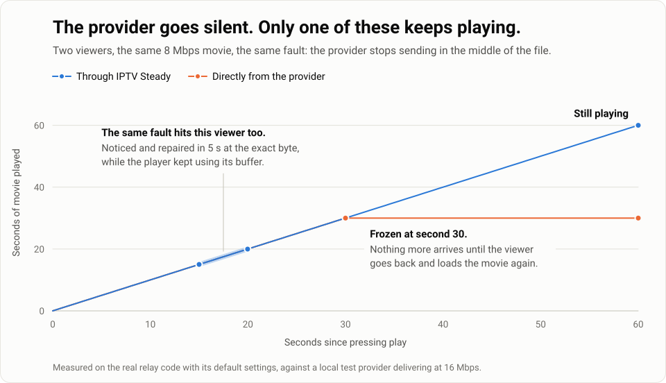
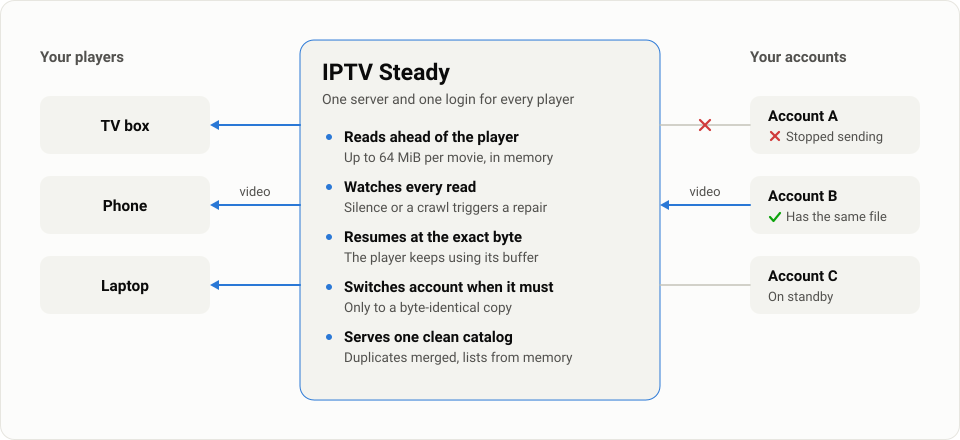
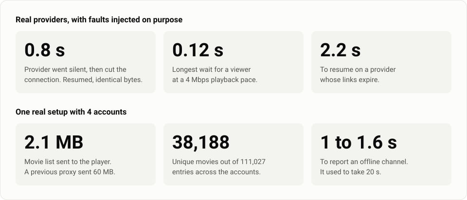

# IPTV Steady

**Your movie froze again and only reloading fixes it? IPTV Steady sits between your players and your Xtream accounts, and repairs the stream while the player keeps going.**

One Go binary, no database, built for small private groups.

[](https://github.com/andresayac/iptv-steady/releases/latest)
[](go.mod)
[](LICENSE)

<picture>
  <source media="(prefers-color-scheme: dark)" srcset="docs/images/freeze-dark.svg">
  
</picture>

## The problem

This project started with something that kept happening at night: a movie would freeze for a long time, sometimes it never came back, and the only way out was to go back and load it again. It happened with the providers' own lists too, so the player was not to blame.

What goes wrong is simple. The provider keeps the connection open but stops sending video. No error reaches the player, so it just waits. Reloading works because it opens a new connection.

IPTV Steady does that reload for you, in seconds, from the exact byte the player needs next. If you have several accounts, it can also continue on another one that holds the same file.

## Does this happen to you?

| What you see | Does it help? |
|---|---|
| A movie or episode freezes and only reloading fixes it | **Yes.** This is what it was built for |
| Playback dies when one provider has a bad night | **Yes**, if another of your accounts has the same file |
| Lists take forever to open in your app | **Yes.** They come from memory and are a fraction of the size |
| The same film appears again and again across accounts | **Mostly.** The same name and year, or the same poster, become one entry |
| Categories are a mess of repeated names | **Yes.** Rename, join and pin them from the configuration |
| A live channel cuts out now and then | **Partly.** It reconnects and switches account, but live has no buffer yet |
| A channel is offline at the provider | **Only** if another account carries it. Otherwise you get a quick error instead of a long wait |
| Your home internet or Wi-Fi is the slow part | **No.** That is between the server and you |
| Every account fails at the same time | **No.** There is nothing left to switch to |

## How it works

<picture>
  <source media="(prefers-color-scheme: dark)" srcset="docs/images/how-it-works-dark.svg">
  
</picture>

When a provider misbehaves during a movie:

1. The server has already downloaded ahead of the player, up to `file.read_ahead` per stream.
2. If the provider sends nothing for `file.stall_timeout`, or crawls below `file.slow_min_rate`, the connection is dropped and reopened at the exact next byte. The player keeps consuming the buffer.
3. If that account keeps failing, playback continues on another account whose file has the same size and matches the last bytes delivered.
4. Without an identical copy, the proxy keeps trying for `file.recovery_budget` and then closes the stream, so the player shows an error instead of hanging forever.

A failed title never splices a different file into a stream, because the result would be corrupt.

## Measured results

<picture>
  <source media="(prefers-color-scheme: dark)" srcset="docs/images/results-dark.svg">
  
</picture>

The chart at the top ran the real relay code with its default settings against a local test provider. The first row above comes from real accounts with faults injected on purpose, and every run was compared byte by byte with a direct download. The second row comes from one real deployment. Your providers will give different numbers.

## Get started

### 1. Get the program

On Linux x86-64:

```sh
curl -fsSL https://github.com/andresayac/iptv-steady/releases/latest/download/iptv-steady_linux_amd64.tar.gz | tar -xz
cd iptv-steady
```

ARM Linux and Windows builds are on the [releases page](https://github.com/andresayac/iptv-steady/releases/latest). To build from source you need Go 1.26: `go build -o iptv-steady ./cmd/iptv-steady`.

### 2. Add your accounts

```sh
cp .env.example .env
cp config.example.yaml config.yaml
```

Open `.env` and fill in who may connect and which accounts to use:

```ini
LISTEN=:8095

PROXY_USER=viewer
PROXY_PASSWORD=change-me

PROVIDER_ONE_URL=https://provider-one.example:2087
PROVIDER_ONE_USER=user
PROVIDER_ONE_PASSWORD=password
```

Each account also needs its block under `accounts:` in `config.yaml`. Add a block for a third account, or remove one if you only have one. A single account still gets the repairs; only switching account needs a second one.

### 3. Start it

```sh
./iptv-steady sync     # download the catalogs once and print a summary
./iptv-steady serve
```

### 4. Connect your player

In any app with an Xtream Codes login:

| Field | Value |
|---|---|
| Server | `http://your-server:8095` |
| Username | `PROXY_USER` from `.env` |
| Password | `PROXY_PASSWORD` from `.env` |

If your app only takes a playlist, use `http://your-server:8095/get.php?username=USER&password=PASSWORD&type=m3u_plus`.

### 5. See what it rescued

```sh
./iptv-steady -days 1 report
```

The report groups interruptions and repairs by hour, account and player. Example:

```text
Events: 18, interruptions: 7, recovered: 7, gave up: 0, dead links: 2

Hour
       interrupted  recovered  gave up  dead links  avg recovery ms
21:00  5            5          0        1           812
22:00  2            2          0        1           640
```

| Command | Purpose |
|---|---|
| `serve` | Start the proxy (default) |
| `sync` | Download every catalog once and print a summary |
| `report` | Summarize interruptions and rescues |

`-config` selects the configuration file and `-days` the period covered by `report`. Both go before the command.

## Run it on a server

From the folder with the program and your `config.yaml` and `.env`:

```sh
sudo useradd --system --home-dir /opt/iptv-steady --shell /usr/sbin/nologin iptv-steady
sudo mkdir -p /opt/iptv-steady/data
sudo cp iptv-steady config.yaml .env /opt/iptv-steady/
sudo chown -R iptv-steady:iptv-steady /opt/iptv-steady
sudo chmod 600 /opt/iptv-steady/config.yaml /opt/iptv-steady/.env
sudo cp deploy/iptv-steady.service /etc/systemd/system/
sudo systemctl daemon-reload
sudo systemctl enable --now iptv-steady
sudo journalctl -u iptv-steady -n 10 --no-pager
```

The log should show a `listening` line. If the port is taken, the service stops and logs the error.

Put a reverse proxy in front for HTTPS, set `PUBLIC_URL` and bind `LISTEN` to localhost. Disable response buffering there, or the rescue buffer will not work as intended; `deploy/nginx.conf.example` shows how. Behind Cloudflare, keep the DNS record unproxied so video does not pass through its CDN.

## Configuration

`config.yaml`, copied from `config.example.yaml`, holds all behavior. Secrets live in `.env` and are referenced as `${NAME}`. Accounts are listed in order of preference. Neither file is committed.

| Section | Controls |
|---|---|
| `file` | Movies and episodes: read-ahead, stall detection, retries, recovery budget |
| `live` | Channels: stall detection and reconnection |
| `upstream` | Timeouts, account polling, circuit breaker |
| `catalog.filters` | What to hide. Adult content is blocked by default |
| `catalog.merge` | Which sections merge duplicates; turn all off for a pure pass-through |
| `catalog.identity` | How titles are recognized as the same |
| `catalog.categories` | Category names, joining and order, shared or per section |
| `catalog.copy_traits` | Which copy of a title plays first |

Restart after changing the configuration. Catalog rules apply right away from the saved catalogs, with no new requests to your providers, and channel numbers stay the same when you rename or join categories.

## Limits

- A provider failure can only be hidden while another attempt succeeds. If every account fails at once, playback stops.
- Problems between this server and the viewer are outside its reach. On Linux, enabling BBR helps over long distances:
  `sysctl -w net.core.default_qdisc=fq net.ipv4.tcp_congestion_control=bbr`.
- Live channels reconnect and switch accounts, but have no buffer yet.
- Channels requested as HLS, or that answer a `.ts` request with an HLS playlist, are redirected to the provider. That exposes its address to the player and leaves those channels without account switching. Providers that only offer HLS should publish `sections: [vod, series]`.
- Identity is based on names, years and posters. The same film under unrelated names stays duplicated.
- The guide comes from the first account that answers. Catch-up is not supported.

## Scale

Built and tested for small private groups, about 4 concurrent viewers on one server. Each relayed stream uses server bandwidth and a bounded memory buffer; larger deployments need their own capacity planning and testing.

This software provides no content: you are responsible for your accounts and for your providers' terms and connection limits.

## Planned

- A buffer and a full HLS relay for live channels
- Optional TMDB enrichment: posters, clean names and joining translated titles
- A web panel

## Tests

```sh
go test -race ./...
```

`internal/testkit` provides a fake Xtream panel that fails on purpose: silence in the middle of a file, dropped connections, trickling data, dead links and connection limits.

## License

[MIT](LICENSE)
